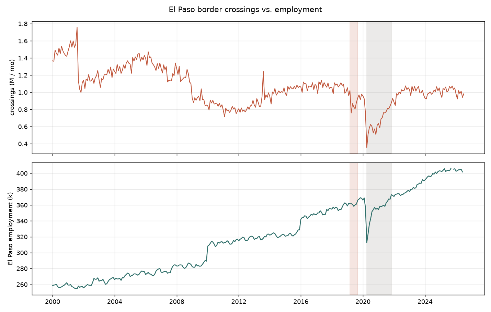
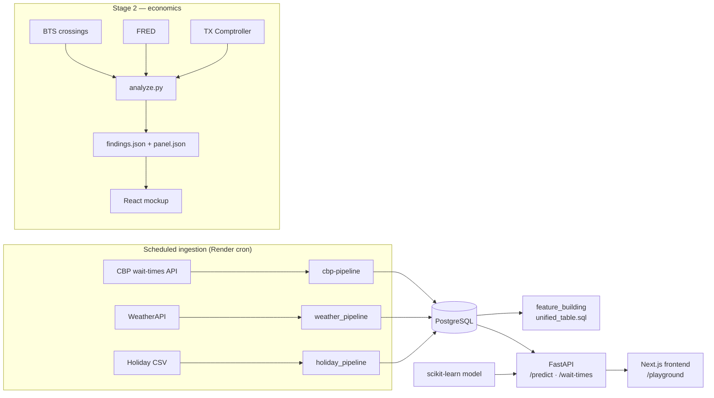

# El Paso–Juárez Border: Wait-Time Forecasting & Economic Impact

Two-stage project on the Bridge of the Americas (BOTA) and the other El Paso ports of entry:

1. **Forecaster** — a full-stack app that ingests CBP wait times, weather and the US/MX
   holiday calendar every hour and serves a wait-time prediction model with a live playground.
2. **Economic study** — an econometric analysis of whether *border friction* (crossing
   volume / wait times) moves with **El Paso economic activity**, including an event study
   of the spring-2019 CBP officer reassignment.

> **Headline finding.** Border-crossing activity and the El Paso–Juárez regional economy move
> together in year-over-year growth — composite crossing index vs. El Paso employment **r ≈ 0.53**,
> vs. retail sales **r ≈ 0.66**. Friction shocks (2019 CBP officer reassignment, COVID land-border
> ban) hit the consumer/commuter channels hard — personal vehicles **−10% / −39%**, with
> substitution to walking (**+28%** pedestrians in 2019) — but **freight is friction-immune**: truck
> crossings, the Juárez→El Paso maquiladora supply chain, show no measurable effect from either shock.

**Live demo:** _TODO_ · **Analysis mockup:** [`mockup/`](mockup) · **Notebook:** [`analysis/`](analysis)



## Architecture



## Repo layout

| Path | What |
|---|---|
| `backend/cbp-pipeline/` | hourly CBP wait-time ingestion |
| `backend/weather_pipeline/`, `backend/holiday_pipeline/` | context features |
| `backend/feature_building/` | `unified_table.sql` — hourly panel of waits + weather + holidays |
| `backend/api/` | FastAPI serving layer (`/predict`, `/wait-times`, `/day-type-effects`) |
| `backend/ml/` | trained wait-time model |
| `backend/database/` | `schema.sql`, `init_db.py` |
| `frontend/` | Next.js app + prediction playground |
| `analysis/` | **Stage 2** — `analyze.py` + narrated notebook (BTS/FRED/Comptroller → econometrics) |
| `mockup/` | **Stage 2** — standalone React data-story front end |
| `render.yaml` | infrastructure-as-code deploy (Postgres + API + cron jobs) |

## Deploy

```bash
# Render dashboard → New → Blueprint → pick this repo → Apply
# then run the `border-wait-times-db-init` job once
```

See `render.yaml` for the full blueprint (free Postgres + FastAPI web service + hourly
CBP cron + schema/holiday-seed cron).

## Local dev

```bash
docker compose up postgres api          # backend + db
cd frontend && npm install && npm run dev
```

## Stage 2 — analysis & mockup

```bash
cd analysis && python -m venv .venv && .venv/bin/pip install -r requirements.txt
.venv/bin/python analyze.py        # fetch data, run models, write mockup/src/data/*.json
cd ../mockup && npm install && npm run dev   # view the data story at :5173
```

## Limitations & next steps

- Public economic data is monthly; the live pipeline now banks minute-level waits for a
  future high-frequency panel.
- Extend the single time series to a panel across US–Mexico sister-city pairs with an
  instrument for wait times; test the friction × Juárez-income interaction.
