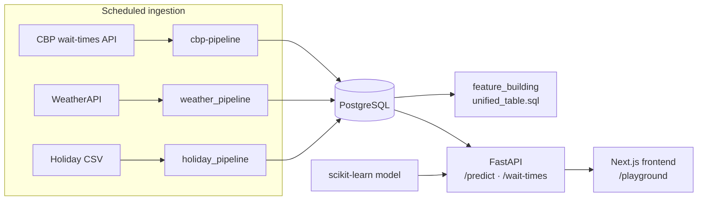

# El Paso–Juárez Border Wait-Time Forecaster

A full-stack app for the Bridge of the Americas (BOTA) and the other El Paso ports of
entry. It ingests CBP wait times, weather, and the U.S./Mexico holiday calendar every
hour, and serves a wait-time prediction model with a live playground.

**Live demo:** _TODO_

## Architecture



## Repo layout

| Path | What |
|---|---|
| `backend/cbp-pipeline/` | hourly CBP wait-time ingestion (`cbp_data_pipeline.py`) |
| `backend/weather_pipeline/` | El Paso + Ciudad Juárez weather |
| `backend/holiday_pipeline/` | U.S./Mexico holiday & school-break calendar (seeded from CSV) |
| `backend/feature_building/` | `unified_table.sql` — hourly panel of waits + weather + holidays |
| `backend/api/` | FastAPI serving layer (`/predict`, `/wait-times`, `/day-type-effects`) |
| `backend/ml/` | trained wait-time model (`*.joblib`) |
| `backend/database/` | `schema.sql`, `init_db.py` |
| `frontend/` | Next.js app + prediction playground |
| `render.yaml` | infrastructure-as-code deploy (Postgres + API + cron jobs) |

## Deploy (Render)

1. Render dashboard → **New → Blueprint** → pick this repo → **Apply**
2. Run the `border-wait-times-db-init` job once (applies `schema.sql`, seeds the holiday calendar)
3. Point the frontend's `API_URL` env var at the deployed API

`render.yaml` provisions a Postgres database, a FastAPI web service, an hourly CBP
ingestion cron, and the schema/holiday-seed cron.

## Local dev

```bash
docker compose up postgres api          # backend + db
cd frontend && npm install && npm run dev
```

Full local stack (all pipelines): `docker compose up`.

## Pipeline

The CBP pipeline runs hourly:

1. Fetch wait times from the CBP API
2. Parse the response
3. Upsert into PostgreSQL (deduplicated on port / lane / timestamp)
4. Record the run in `ingestion_logs`

Logs: `logs/pipeline.log`, `logs/scheduler.log`.
