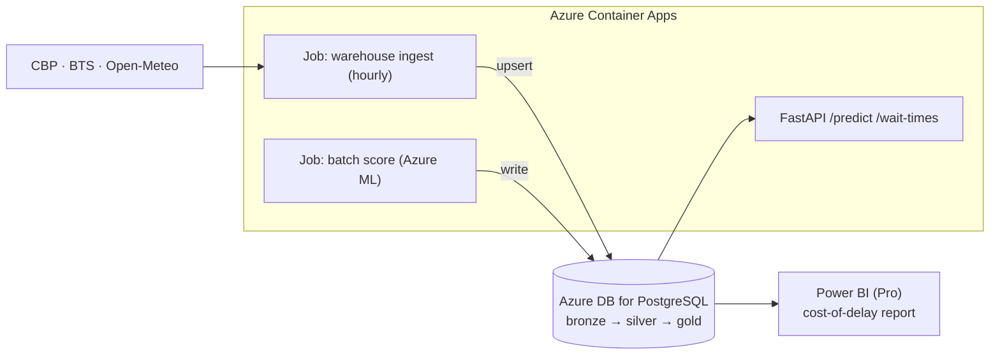

# Migrating to Azure Database for PostgreSQL

The whole platform — wait-time app **and** the border-delay cost warehouse — runs on
one **Azure Database for PostgreSQL – Flexible Server**. No Fabric, no Databricks.

## Why Postgres, not Fabric

| | Azure PG (B1ms) | Fabric F2 |
|---|---|---|
| ~cost/month | **$15–20** (stoppable) | ~$260 (after 60-day trial) |
| data volume here | gold fact ≈ 1M rows — trivial | overkill |
| existing code reuse | `schema.sql`, `psycopg2` pipelines, `init_db.py` | rewrite |
| Power BI | native connector, Import mode (loads in seconds) | Direct Lake |

## Target architecture



## 1. Provision

```bash
az login
az group create -n borderplex-rg -l southcentralus

az postgres flexible-server create \
  -g borderplex-rg -n borderplex-pg \
  --tier Burstable --sku-name Standard_B1ms \
  --storage-size 32 --version 16 \
  --admin-user bwtadmin --admin-password '<strong-password>' \
  --public-access 0.0.0.0    # or set up a VNet / private endpoint

# enable pg_cron (optional — ingest.py already refreshes gold itself)
az postgres flexible-server parameter set \
  -g borderplex-rg -s borderplex-pg --name azure.extensions --value pg_cron
```

Create the database:

```bash
az postgres flexible-server db create -g borderplex-rg -s borderplex-pg -d border_wait_times
```

## 2. Apply schema

```bash
export DATABASE_URL="postgres://bwtadmin:<pw>@borderplex-pg.postgres.database.azure.com:5432/border_wait_times?sslmode=require"

# app tables (existing)
psql "$DATABASE_URL" -f backend/database/schema.sql
python backend/database/init_db.py        # + seeds the holiday calendar

# the warehouse
backend/warehouse/apply.sh
```

## 3. First load

```bash
DB_HOST=borderplex-pg.postgres.database.azure.com DB_PORT=5432 \
DB_NAME=border_wait_times DB_USER=bwtadmin DB_PASSWORD='<pw>' \
  python -m backend.warehouse.ingest
```

## 4. Schedule the hourly refresh

**Option A — Container Apps Job** (recommended; runs the ingestion + refresh):

```bash
az containerapp job create \
  -g borderplex-rg -n bwt-ingest \
  --environment <aca-env> \
  --trigger-type Schedule --cron-expression "15 * * * *" \
  --image <acr>/bwt-warehouse:latest \
  --command "python" "-m" "backend.warehouse.ingest" \
  --secrets db-password='<pw>' \
  --env-vars DB_HOST=... DB_NAME=border_wait_times DB_USER=bwtadmin DB_PASSWORD=secretref:db-password
```

**Option B — pg_cron only** (if ingestion runs elsewhere):

```sql
CREATE EXTENSION IF NOT EXISTS pg_cron;
SELECT cron.schedule('medallion-refresh', '15 * * * *', 'CALL gold.refresh_medallion()');
```

## 5. Azure ML → `gold.fact_wait_forecast`

Train a commercial-lane wait model (features: `dim_date` + `silver.weather_daily` +
`silver.holidays` + lagged `silver.commercial_wait_hourly`), register it, and run a
**batch endpoint** that writes predictions to a `gold.fact_wait_forecast` **table**
(drop the matview, `CREATE TABLE` with the same columns). The cost model picks them
up on the next refresh — no other change.

## 6. Power BI

- **Get Data → PostgreSQL** → `borderplex-pg.postgres.database.azure.com`, database
  `border_wait_times`, **Import**.
- Load `gold.fact_border_delay_cost`, `gold.dim_port`, `gold.dim_date`,
  `gold.dim_scenario`, `gold.dim_cost_params`.
- Relationships + measures: [`../powerbi/`](../powerbi) (the DAX and page spec are
  storage-agnostic).
- Publish to a Pro workspace; share the link, or embed in a Container Apps web shell.
- Use an **on-premises data gateway** or Power BI's Postgres cloud connector; refresh
  the dataset hourly.

## 7. Cutover / decommission

Point the existing pipelines' `DB_*` at the Azure server, migrate historical
`wait_times` with `pg_dump | psql`, then shut down Render + the old Postgres.

## Cost model assumptions

| Parameter | Value | Source |
|---|---|---|
| truck operating cost | $95/hr all-in | ATRI *Operational Costs of Trucking* |
| inventory carrying rate | 20%/yr | logistics literature |
| cargo value / truck | $95k–$165k by port | BTS TransBorder aggregates (replace with monthly actuals) |
| JIT line-stoppage cost | $2,500 / exposed truck | assumption — a Power BI what-if parameter |
| reliability threshold | 75 min wait | assumption |

In the 2019 CBP officer reassignment, commercial lanes were **prioritised** and truck
volume barely moved — `commercial_disruption` models the counterfactual.
