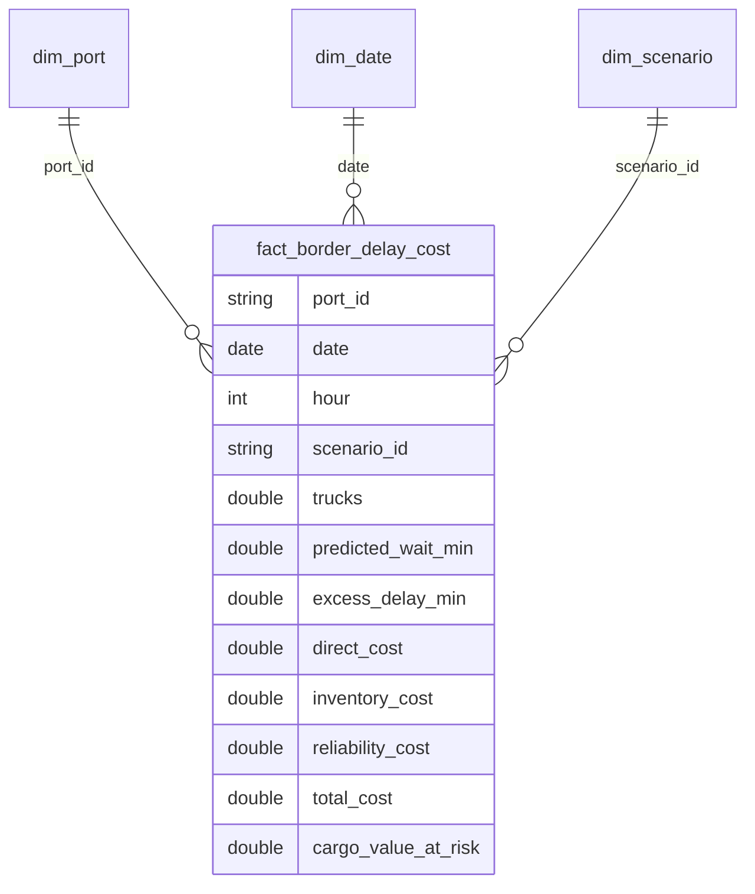

# Semantic model

## Tables (from `borderplex.gold`)

| Table | Grain | Storage | Notes |
|---|---|---|---|
| `fact_border_delay_cost` | port × date × hour × scenario | Import | the fact; ~1 M rows |
| `dim_port` | port | Import (dual) | `port_id`, `port_name`, `city`, `free_flow_min`, `cargo_value_per_truck_usd`, `jit_share` |
| `dim_date` | day | Import (dual) | mark as date table on `date` |
| `dim_scenario` | scenario | Import (dual) | `scenario_id`, `scenario_name`, `added_wait_min`, `volume_multiplier` |
| `dim_cost_params` | parameter | Import | key/value; surfaced as editable what-if defaults |

## Relationships (all single-direction, many-to-one from the fact)

```
fact_border_delay_cost[port_id]     → dim_port[port_id]
fact_border_delay_cost[date]        → dim_date[date]
fact_border_delay_cost[scenario_id] → dim_scenario[scenario_id]
```

## What-if parameters (New parameter → Numeric range)

The gold table pre-computes all five named scenarios. These parameters let the report
**re-scale** the cost on the fly without a round-trip:

| Parameter | Range | Default | Drives |
|---|---|---|---|
| `p_added_wait` | 0–120 min, step 5 | 0 | extra delay on top of the selected scenario |
| `p_truck_hourly_cost` | 60–160 $, step 5 | 95 | ATRI operating cost |
| `p_carrying_rate` | 0.10–0.35, step 0.01 | 0.20 | inventory carrying rate |
| `p_stoppage_cost` | 0–8000 $, step 250 | 2500 | JIT line-stoppage cost per exposed truck |
| `p_volume_growth` | 0.8–1.5, step 0.05 | 1.0 | truck-volume multiplier |

Each `Generate Series` table is disconnected (no relationship); the measures below read
`SELECTEDVALUE(p_x[p_x], default)`.

## Model diagram



## Row-level security (optional)

`dim_port` role by `city` if the report is shared with multiple border regions later.
